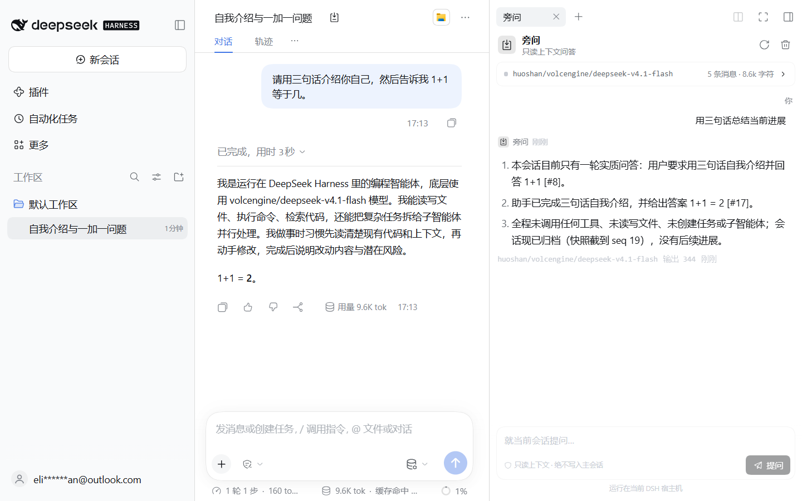
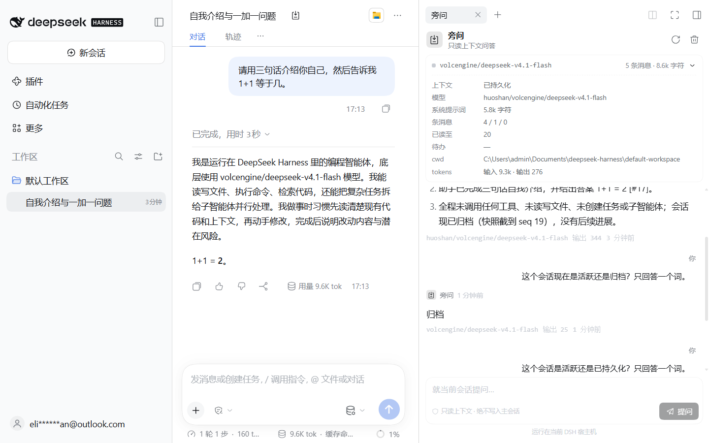
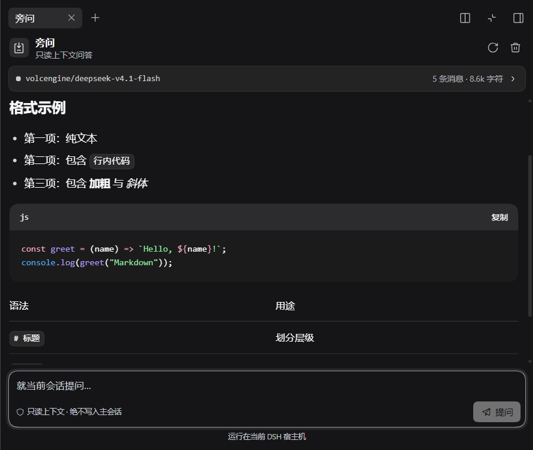
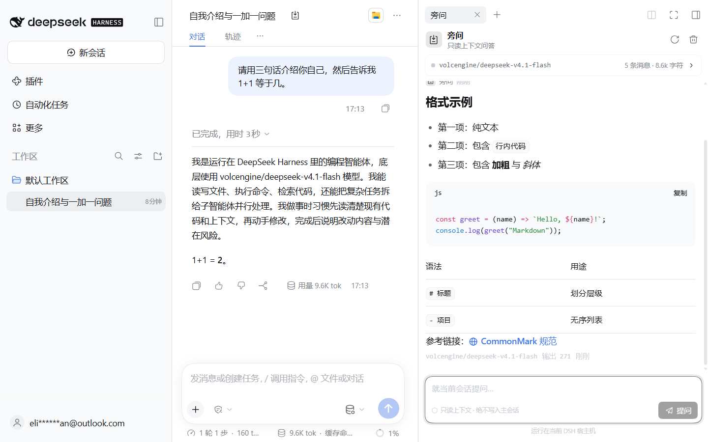

# dsh-sidecar · 旁问

[](https://github.com/EliasKaslan/dsh-sidecar/actions/workflows/ci.yml)
[](LICENSE)

**Ask questions about the current DeepSeek Harness session — without writing a single message into it.**

`dsh-sidecar` adds a right-sidebar panel to the DSH web client. It reads the same model-visible context the main agent is using (system prompt, transcript, tool calls and results, todos, goal, token usage) and answers in the side panel through one auxiliary model call. The main session is never appended to, never steered, and never interrupted.

[中文说明](README.zh.md) · GitHub `EliasKaslan/dsh-sidecar` · GitCode `EliasKaslan/dsh-sidecar`



## Why

The main session's context is the most expensive state in an agent run. A normal follow-up question mutates it: another user message, another assistant turn, another compaction boundary. Sidecar gives you a separate channel for "what is going on?", "why did that fail?", "what should we do next?" while the main transcript stays exactly as it was.

The read-only guarantee is mechanical, not a prompt convention:

- the host service calls `ctx.sessionQuery.readSurface()` / `observeSession()` only;
- it never calls `session.append()` or any session mutation;
- the side answer is one `ctx.llm` stream with its own message list;
- the browser keeps side history in `localStorage`, keyed per session.

## Features

- **Right-sidebar tab + conversation-header button.** Opens as a normal dock tab, with the guide entry as a second entry point.
- **Live context card.** Agent-resident state, model route, context window, message mix, system-prompt size, tool results, todos, goal, token usage, and truncation notice.
- **Read-only side Q&A.** Markdown answers with code fences, tables, links, and KaTeX, streamed into the panel through a small polling protocol.
- **Stop, retry, copy, clear.** Two-step clear; stopped answers can be retried; answers copy as plain text.
- **Per-session history.** Survives reloads and host restarts; jobs live on the host for 30 minutes and resume polling after a page reload.
- **Theme-native.** Uses the DSH `--dsw-alias-*` tokens; light and dark, normal and fullscreen, narrow layouts.
- **Accessible.** Region/log landmarks, labels, focus-visible rings, Escape to stop, Enter to send, Shift+Enter for newline, reduced-motion support.

| Context details | Dark theme | Markdown |
| --- | --- | --- |
|  |  |  |

## Requirements

- DeepSeek Harness `0.2.2-rc.1` (desktop or web profile), Node.js 22.15+.
- A model route the host can call: the current session's last route, the agent default model, or an explicit `provider` / `model` on the plugin row.

## Install

### Option A — plugin manager (bundle)

The package declares `dsh.bundle.patch`, so DSH's plugin manager can install it as a bundle:

1. Settings → Plugins → install from a local path, a `.tgz`, or the published package.
2. Enable `dsh-sidecar`.
3. The bundle inserts the `sidecar` row automatically.

### Option B — manual profile bundle (development)

```powershell
# 1) put the repository anywhere, e.g. D:\work\dsh-sidecar
cd $env:USERPROFILE\.dsh\profiles\desktop
# 2) edit package.json:
#    dependencies."dsh-sidecar" = "link:D:/work/dsh-sidecar"
#    dsh.profile.bundles       += "dsh-sidecar"
pnpm install
# 3) restart DSH, or touch ~/.dsh/cordis.patch.yml to ask HMR to recompose
```

The bundle's own `cordis.patch.yml` inserts the `sidecar` row; do not add a second row by hand. That is also why a bare `cordis.patch.yml` row is not enough for the Plugins page: it loads the plugin, but the app lists only profile bundles. A manifest edit (`package.json` of the plugin) needs a host restart; a bundle-selection edit is picked up by HMR or the next restart.

> The `desktop` profile is managed by the Electron app; the standalone `dsh plugin` CLI refuses it. Use **Add plugin** or the manual profile edit above.

### Option C — from source

```powershell
git clone <repo> dsh-sidecar
cd dsh-sidecar
npm install
npm run verify        # typecheck + build + syntax check + 12 tests
```

## Configuration

All fields are optional. They belong to the `config:` block of the `sidecar` row.

| Field | Default | Meaning |
| --- | --- | --- |
| `provider` | — | Explicit provider id. Must be paired with `model`. |
| `model` | — | Explicit model id. |
| `maxTokens` | `2048` | Output cap for one side answer. |
| `maxContextChars` | `96000` | Character budget for the read-only snapshot (not tokens). |
| `maxHistoryMessages` | `8` | Previous side Q&A messages forwarded as history. |
| `reasoningEffort` | — | Optional effort override. By default Sidecar does **not** inherit the main loop's `max` effort. |

Route resolution order: explicit `provider` + `model` on the row → the current session's last `request/context` route → `agentDefaultModel.currentSelection()`.

## How it works

```
┌──────────────────────────── browser ────────────────────────────┐
│  sidebar.right.pane.tab  (client plugin, prebuilt CJS bundle)   │
│    ├─ ContextCard  ← sidecar/snapshot                           │
│    └─ Thread       ← sidecar/ask → sidecar/poll → sidecar/cancel│
└───────────────────────────────┬─────────────────────────────────┘
                                │  unary /api RPC (Typert Gateway)
┌───────────────────────────────▼─────────────────────────────────┐
│  Sidecar service (host cordis plugin)                           │
│    ├─ sessionQuery.readSurface / observeSession  (read-only)    │
│    ├─ buildSnapshot → system prompt + conversation + metadata   │
│    └─ ctx.llm.prepareCall → call.stream (own message list)      │
└─────────────────────────────────────────────────────────────────┘
```

The host service is a Cordis `TypertRemoteService` named `sidecar`, namespace `sidecar`. It exposes four methods:

| Method | Purpose |
| --- | --- |
| `snapshot(sessionId)` | UI-facing context summary; no model call. |
| `ask({ sessionId, question, history })` | Creates a job and returns `{ jobId }` immediately. |
| `poll(jobId, cursor)` | Returns the text delta since `cursor`, state, error, usage. |
| `cancel(jobId)` | Aborts the model stream. |

The gateway discovers the service through the standard `typertRemote` binding and a prototype marker, so the plugin does not need a generator or a build-time Typert artifact. `signal` is the literal final parameter of each method, as the source-mode signature contract requires.

### Snapshot rules

- System prompt: the last non-empty `system/message` in the folded surface.
- Conversation: `user/message`, `assistant/message` (text + tool-call names/args), `tool/result` (tool name resolved from the matching call), and `developer/message`.
- Reasoning blocks are deliberately dropped; Sidecar never re-exposes private chain-of-thought.
- Metadata: `agent` resident state, `request/context` route, `request/header` config, token projections, todos, goal, compaction count.
- Budget: newest messages are kept first, the opening user message is kept if it fits, old messages are omitted with a count. Tool results are clipped per message.
- Cold sessions: `readSurface` is tried first; strict-surface failures fall back to `readSession`. A session that cannot be loaded returns `sidecar/session-unavailable`.

## Security and privacy

- Sidecar reads the same context the main agent already sends to its model provider. That snapshot is sent **to the same configured model provider** for the side answer. Do not use it in a session whose context must not reach that provider.
- No extra network endpoints, telemetry, or cloud services. The RPC stays on the DSH host; the model call uses `ctx.llm`.
- No tool execution: Sidecar cannot run commands, read files on demand, or call MCP tools. It only summarizes what the snapshot contains.
- Side history is `localStorage` data in the DSH web origin. The host keeps jobs in memory and drops them after 30 minutes. `Clear` removes the thread from `localStorage`; running jobs are cancelled.
- Tool output and file contents can contain prompt-injection text. The system prompt marks the snapshot as data, and the service has no tools, so the worst case is a bad answer, not an action.

## Development

```powershell
npm install
npm run build          # lib/index.js + lib/client.js
npm run check:syntax   # Node parse + ModuleLoader wrapper assertions
npm test               # 12 unit/contract tests
npm run typecheck
npm run verify         # all of the above
```

The client half must be a **prebuilt self-registering CJS factory**. `scripts/build.mjs` bundles `src/client/index.tsx` with esbuild, keeps React and the DSH platform modules external, and wraps the output in:

```js
window.__ModuleLoader__.load({
  id: "dsh-sidecar",
  factory: (require) => { /* ... */ return module.exports }
})
```

The host half is ordinary ESM with every `@deepseek-ai/*` import left external, so it resolves against the running DSH installation.

### Acceptance performed

- 12 tests: snapshot semantics, tool-call/result mapping, truncation, `readSurface` fallback, cold-lease state, no event mutation, manifest shape, service marker, literal `signal` position, client bundle purity.
- Isolated DSH web host (`DSH_HOME` redirected, port 3099) on a second profile: boot graph contains `dsh-sidecar`, `/plugins/??dsh-sidecar/client.js&rev=...` returns 200, stale rev 404.
- End-to-end: header button → right tab → context card → question → streamed Markdown answer → copy/stop/retry/clear.
- Read-only proof: the main session's `session.v4.jsonl.zstd` stayed at 17,572 bytes and the same mtime across several side questions.
- Theme matrix: light, dark, normal, fullscreen (900 px), narrow.
- Per-session isolation: a second session opens an empty thread; switching back restores the first thread.
- Concurrency: a side question asked while the main turn is running returns "agent resident" and does not disturb the turn.

## Limitations

- Read-only by design: no follow-up tool use, no file reads, no "apply this".
- The snapshot is a point-in-time read; it does not stream main-session deltas into the panel.
- A job is kept for 30 minutes; a reload resumes polling only while the host still has it.
- Cold sessions need the persistence/query services of the running composition.
- The answer is only as good as the folded context; reasoning blocks and images are not included.

## License

MIT. See [LICENSE](LICENSE) and [THIRD-PARTY-NOTICES.md](THIRD-PARTY-NOTICES.md).
