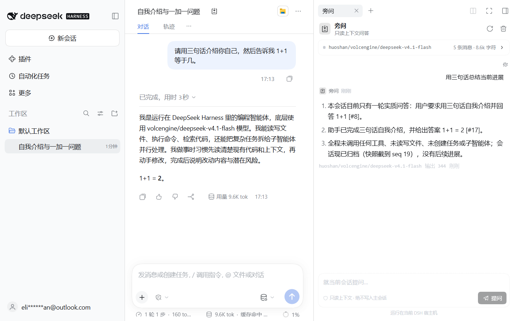
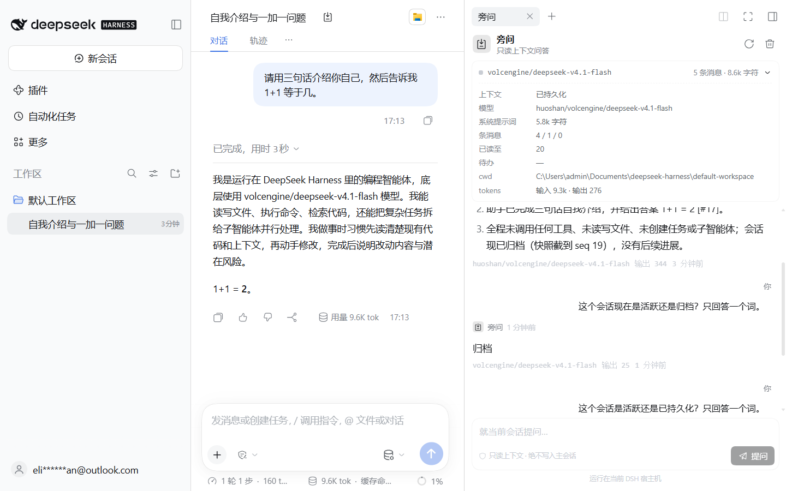
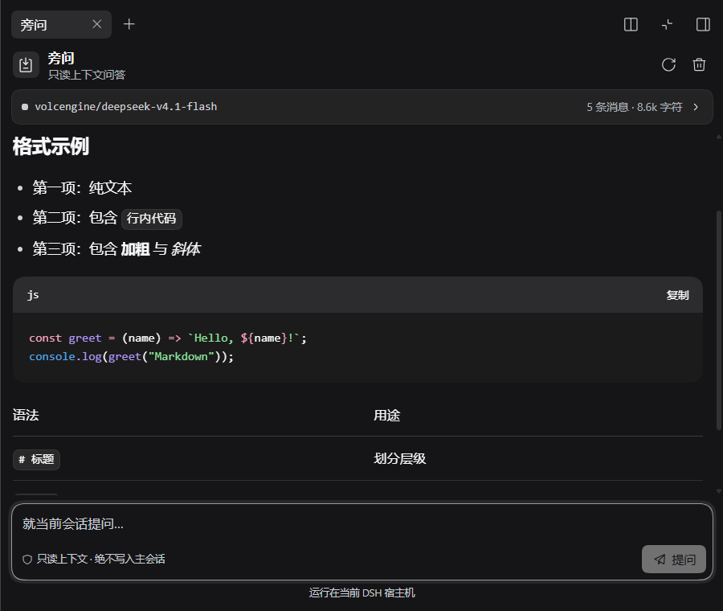
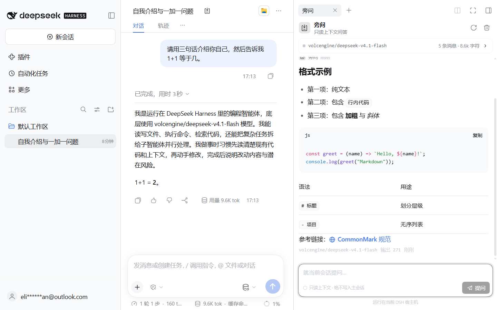

# dsh-sidecar · 旁问

**就当前 DSH 会话提问，但绝不向主会话写入任何一条消息。**

`dsh-sidecar` 在 DSH Web 客户端里加一个右侧边栏面板。它读取主 agent 正在使用的同一份“模型可见上下文”（系统提示词、对话、工具调用与结果、待办、目标、token 用量），用一次独立的辅助模型调用在侧栏作答。主会话不会被追加消息、不会被改道，也不会被打断。

[English](README.md)



## 为什么需要它

主会话的上下文是一次 agent 运行里最贵的状态。普通追问会改变它：再多一条 user 消息、再多一轮 assistant、再多一个压缩边界。旁问提供另一条通道，用来问“现在进展到哪了？”“刚才为什么报错？”“下一步做什么？”，而主 transcript 保持原样。

只读不是靠提示词约定，而是机制保证：

- 宿主只调用 `ctx.sessionQuery.readSurface()` / `observeSession()`；
- 从不调用 `session.append()` 或任何会话写接口；
- 侧栏回答是一次独立的 `ctx.llm` 流，消息列表由自己构造；
- 浏览器把侧栏历史存在 `localStorage`，按 sessionId 隔离。

## 功能

- **右侧边栏页签 + 会话标题栏按钮**：像文件/浏览器/终端一样作为 dock tab 打开，guide 入口作为第二个入口。
- **上下文卡片**：agent 是否驻留、模型路由、上下文窗口、消息构成、系统提示词大小、工具结果数、待办、目标、token 用量与截断提示。
- **只读旁问**：Markdown 回答，支持代码块、表格、链接、KaTeX；通过轮询协议逐段流入面板。
- **停止 / 重试 / 复制 / 清空**：清空是两次点击确认；已停止的回答可重试；回答可复制为纯文本。
- **按会话保存历史**：刷新页面、重启 host 后仍在；宿主任务保留 30 分钟，刷新后可继续轮询。
- **跟随主题**：使用 DSH 的 `--dsw-alias-*` 变量；浅色/深色、常规/全屏、窄窗口都适配。
- **可访问性**：region/log 语义、label、focus-visible、Esc 停止、Enter 发送、Shift+Enter 换行、reduced-motion。

| 上下文详情 | 深色主题 | Markdown |
| --- | --- | --- |
|  |  |  |

## 环境要求

- DeepSeek Harness `0.2.2-rc.1`（桌面端或 web profile），Node.js 22.15+。
- 宿主可调用的模型路由：当前会话最后一次请求的路由、agent 默认模型，或在插件行上显式写 `provider` / `model`。

## 安装

### 方式 A — 插件管理器（bundle）

包内声明了 `dsh.bundle.patch`，DSH 插件管理器可以把本包当 bundle 安装：

1. 设置 → 插件 → 从本地目录 / `.tgz` / 已发布包安装。
2. 启用 `dsh-sidecar`。
3. bundle 会自动插入 `sidecar` 行。

### 方式 B — 手工 link（开发）

```powershell
# 1) 仓库放在任意位置，例如 D:\work\dsh-sidecar
# 2) link 进 profile
cd $env:USERPROFILE\.dsh\profiles\desktop
# 在 package.json 的 dependencies 里加：
#   "dsh-sidecar": "link:D:/work/dsh-sidecar"
pnpm install

# 3) 把下面这段追加到 profile 的 cordis.patch.yml
#    C:\Users\admin\.dsh\profiles\desktop\cordis.patch.yml
- insert:
    - id: sidecar
      name: 'dsh-sidecar'
      config:
        maxTokens: 2048
        maxContextChars: 96000
```

patch 层改动会热重载；页签没出现时刷新页面。改插件自己的 `package.json` 清单需要重启 host。

> `desktop` profile 由 Electron 应用独占，独立 `dsh plugin` CLI 会拒绝它。请用应用内插件管理器，或上面的手工 link。

### 方式 C — 从源码

```powershell
git clone <repo> dsh-sidecar
cd dsh-sidecar
npm install
npm run verify        # typecheck + build + 语法检查 + 12 个测试
```

## 配置

所有字段都可选，写在 `sidecar` 行的 `config:` 里。

| 字段 | 默认 | 含义 |
| --- | --- | --- |
| `provider` | — | 显式 provider id，必须与 `model` 成对。 |
| `model` | — | 显式 model id。 |
| `maxTokens` | `2048` | 单次侧栏回答的输出上限。 |
| `maxContextChars` | `96000` | 只读快照的字符预算（不是 token）。 |
| `maxHistoryMessages` | `8` | 作为历史带回的侧栏 Q&A 条数。 |
| `reasoningEffort` | — | 可选推理等级。默认**不**继承主循环的 `max`。 |

路由解析顺序：行上显式 `provider` + `model` → 当前会话最后一条 `request/context` → `agentDefaultModel.currentSelection()`。

## 工作原理

```
┌──────────────────────────── 浏览器 ──────────────────────────────┐
│  sidebar.right.pane.tab（客户端插件，预构建 CJS bundle）          │
│    ├─ ContextCard  ← sidecar/snapshot                            │
│    └─ Thread       ← sidecar/ask → sidecar/poll → sidecar/cancel │
└───────────────────────────────┬──────────────────────────────────┘
                                │  一元 /api RPC（Typert Gateway）
┌───────────────────────────────▼──────────────────────────────────┐
│  Sidecar 服务（宿主 cordis 插件）                                 │
│    ├─ sessionQuery.readSurface / observeSession（只读）           │
│    ├─ buildSnapshot → 系统提示词 + 对话 + 元数据                  │
│    └─ ctx.llm.prepareCall → call.stream（独立消息列表）           │
└──────────────────────────────────────────────────────────────────┘
```

宿主服务是名为 `sidecar` 的 Cordis `TypertRemoteService`，namespace 为 `sidecar`，暴露四个方法：

| 方法 | 作用 |
| --- | --- |
| `snapshot(sessionId)` | 给 UI 的上下文摘要，不调用模型。 |
| `ask({ sessionId, question, history })` | 创建任务并立即返回 `{ jobId }`。 |
| `poll(jobId, cursor)` | 返回自 `cursor` 起的增量文本、状态、错误、usage。 |
| `cancel(jobId)` | 中断模型流。 |

网关通过标准的 `typertRemote` 绑定 + 原型 marker 发现服务，因此插件不需要 generator，也不需要构建期 Typert 产物。每个方法的 `signal` 必须是字面量最后一个参数，这是 source-mode 签名契约的要求。

### 快照规则

- 系统提示词：折叠后 surface 里最后一条非空 `system/message`。
- 对话：`user/message`、`assistant/message`（文本 + 工具名/参数）、`tool/result`（用 callId 反查工具名）、`developer/message`。
- 推理块刻意丢弃；旁问不会重新暴露私有思维链。
- 元数据：agent 是否驻留、`request/context` 路由、`request/header` 配置、token 投影、待办、目标、压缩次数。
- 预算：优先保留最新消息；首条 user 消息放得下就保留；被省略的旧消息带计数。单条工具结果会截断。
- 冷会话：先 `readSurface`；严格 surface 校验失败则退 `readSession`。都读不到返回 `sidecar/session-unavailable`。

## 安全与隐私

- 旁问读取的上下文，主 agent 本来就会发给它的模型提供方；这份快照会**发给同一个已配置的模型提供方**用于侧栏回答。不要让不能到达该提供方的上下文出现在会话里。
- 没有额外网络端点、遥测或云服务。RPC 留在 DSH 宿主；模型调用走 `ctx.llm`。
- 不能执行工具：旁问不能跑命令、按需读文件或调用 MCP 工具，只能总结快照里已有的内容。
- 侧栏历史是 DSH web origin 下的 `localStorage`。宿主只在内存里保留任务，30 分钟后丢弃。点“清空”会删除该会话的 `localStorage` 并取消运行中的任务。
- 工具输出和文件内容可能包含 prompt injection。系统提示词把快照标记为数据，且服务没有工具，最坏情况是回答质量受损，而不是产生动作。

## 开发

```powershell
npm install
npm run build          # lib/index.js + lib/client.js
npm run check:syntax   # Node 解析 + ModuleLoader 包装断言
npm test               # 12 个单元/契约测试
npm run typecheck
npm run verify         # 以上全部
```

客户端半必须是**预构建的自注册 CJS factory**。`scripts/build.mjs` 用 esbuild 打包 `src/client/index.tsx`，把 React 和 DSH 平台模块保持 external，再把输出包进：

```js
window.__ModuleLoader__.load({
  id: "dsh-sidecar",
  factory: (require) => { /* ... */ return module.exports }
})
```

宿主半是普通 ESM，所有 `@deepseek-ai/*` import 保持 external，运行时从 DSH 安装解析。

### 已完成的验收

- 12 个测试：快照语义、工具调用/结果映射、截断、`readSurface` 回退、冷 lease 状态、不修改事件、清单形状、服务 marker、`signal` 字面量位置、客户端 bundle 纯净度。
- 隔离 DSH web host（重定向 `DSH_HOME`、端口 3099、独立 profile）：boot graph 含 `dsh-sidecar`，`/plugins/??dsh-sidecar/client.js&rev=...` 返回 200，旧 rev 返回 404。
- 端到端：标题栏按钮 → 右侧页签 → 上下文卡片 → 提问 → 流式 Markdown 回答 → 复制/停止/重试/清空。
- 只读证据：多次侧栏提问前后，主会话的 `session.v4.jsonl.zstd` 一直是 17,572 字节、mtime 不变。
- 主题矩阵：浅色、深色、常规、全屏（900 px）、窄窗口。
- 按会话隔离：新会话打开是空线程；切回旧会话恢复旧线程。
- 并发：主会话正在跑时提问，侧栏回答显示“活跃”，主 turn 不受影响。

## 限制

- 设计上只读：不能追问式调用工具、不能按需读文件、不能“帮我改一下”。
- 快照是某一时刻的读；不会把主会话增量实时推进面板。
- 任务保留 30 分钟；刷新后只有在宿主仍持有该任务时才能续轮询。
- 冷会话依赖当前组合里的 persistence / query 服务。
- 回答质量取决于折叠后的上下文；推理块和图片不在快照里。

## 许可证

MIT。见 [LICENSE](LICENSE) 与 [THIRD-PARTY-NOTICES.md](THIRD-PARTY-NOTICES.md)。
